# Звіт до роботи
## Тема: Покриття коду
### Мета роботи: Покриття показує, які рядки та розгалуження програми були виконані тестами. Воно допомагає знайти неперевірений код, але саме по собі не доводить якість тестів.

---
## Виконання роботи:

Посилання на папку з виконаними матеріалами лекцій [тут](/OOP/testing/test_3/lecture/)

* Результати виконання завдання:
    1. Виконано перше тестування тестів ще до покриття коду: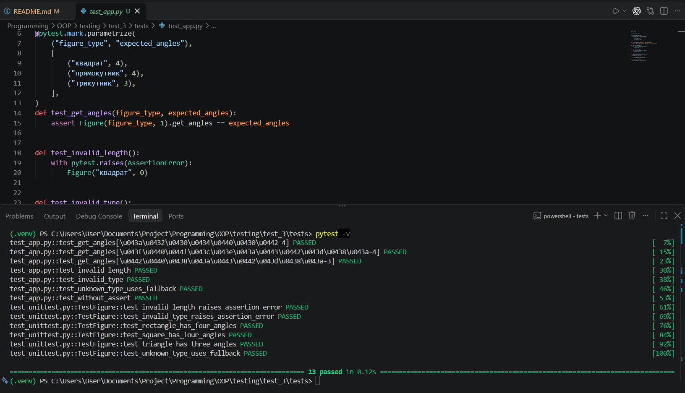
    2. Результат вимірювання покриття коду тестами pytest: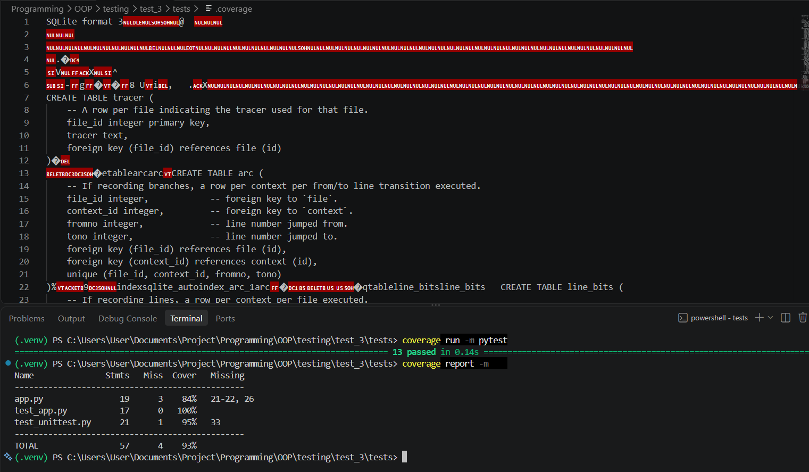
    3. Результат виконання тестів unittest та вимірювання покриття: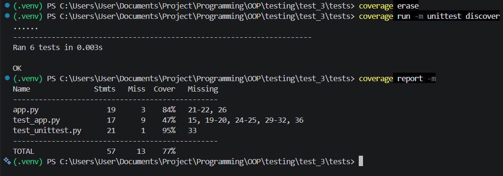
    4. Результат покриття різних гілок програми тестами pytest: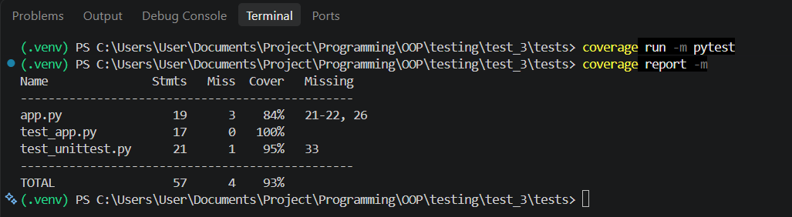
    5. Загальний HTML-звіт покриття коду: 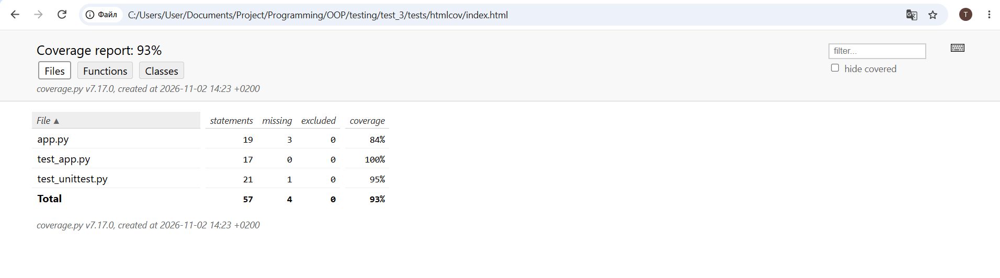
    6. Детальний HTML-звіт виконання рядків програми: 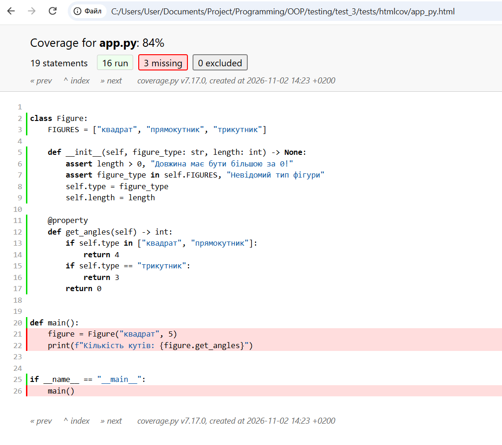
    7. Перевірка налаштувань конфігурації coverage.py: 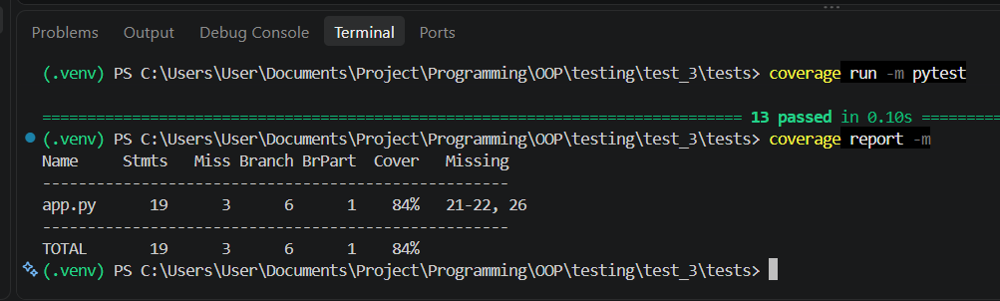
    8. Використання pragma: no cover для виключення точки входу: 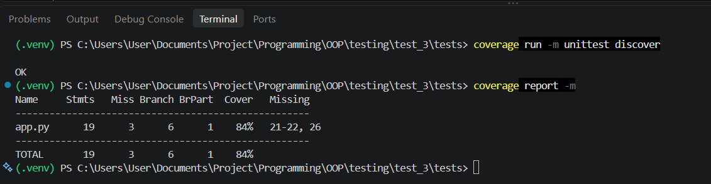
    9. Створено звіт у форматі XML [тут](/OOP/testing/test_3/tests/coverage.xml)
    10. Перевірено те що Coverage не гарантує якість текстів, було додано наступний код до програми test_app.py:
    ```python
    def test_get_angles_without_assert():
    figure = Figure("квадрат", 1)
    assert figure.get_angles == 4
    ```
    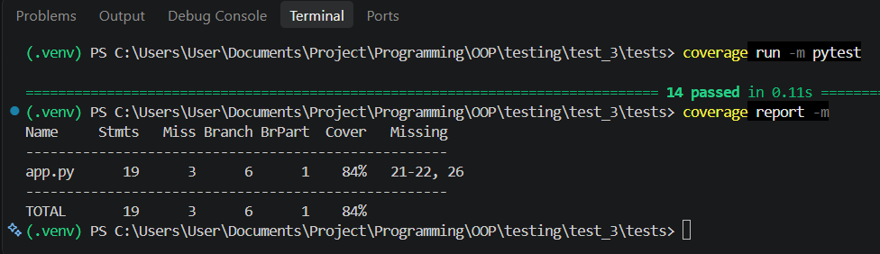
    11. Результат перевірки покриття рядків та розгалужень програми: 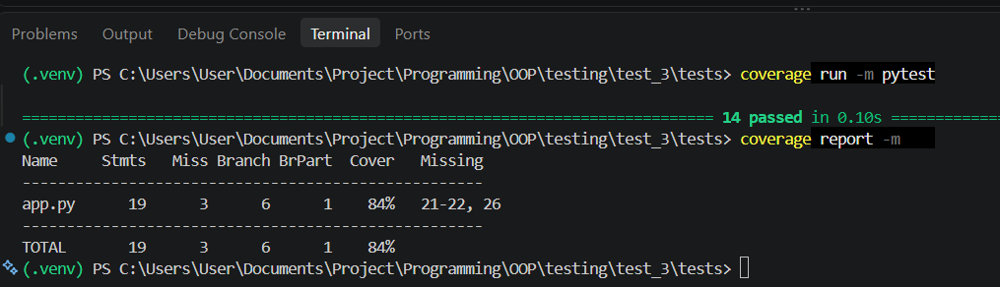
    12. Перевірка мінімального порогу покриття коду 90%: 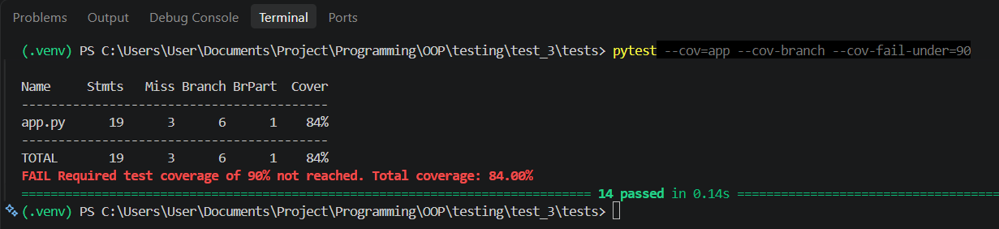
    13. Автоматична перевірка покриття коду за допомогою GitHub Actions: 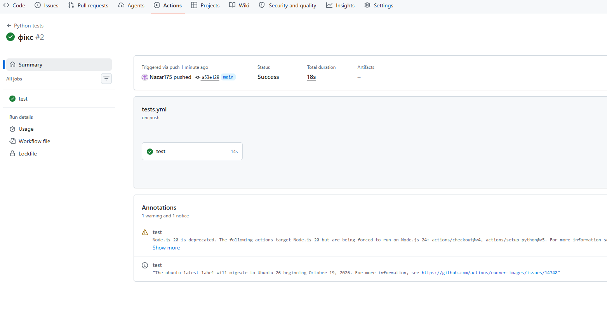
    ---

    Сама програма з виконаними завданнями [тут](/OOP/testing/test_3/tests/)
    ---
---
### Висновок:
- Виконано перше завдання з покриття коду;
- Мета була досягнута;
- Отримані знання по покриттю коду;
- Так;
- Так;
- Складностей під час роботи не виникало;
- Формат подобається.
---