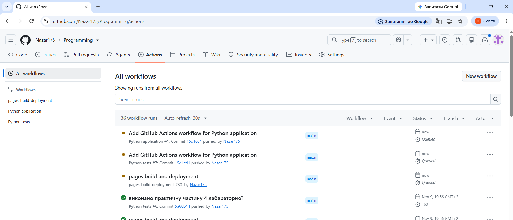
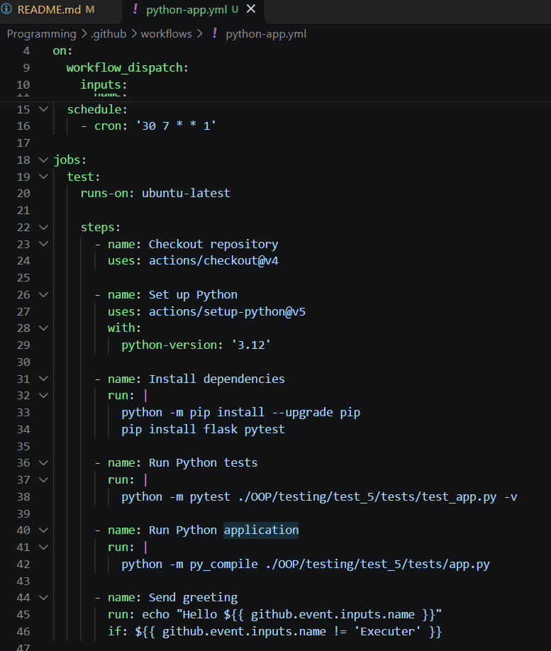
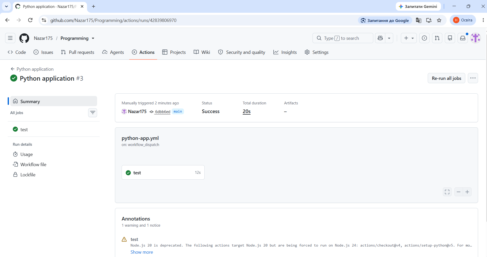
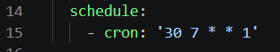
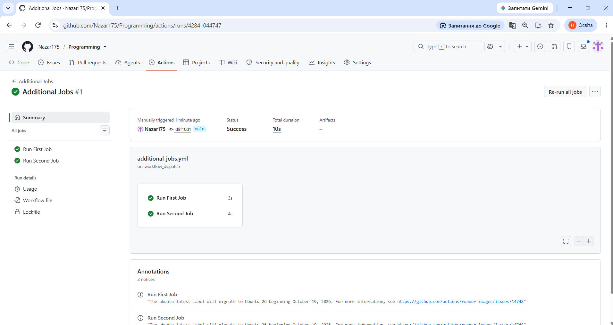
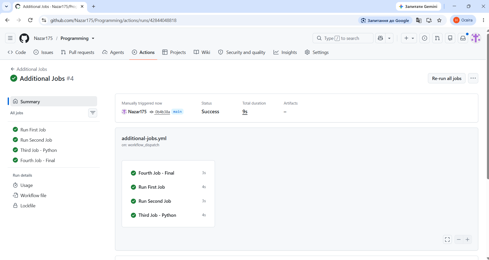
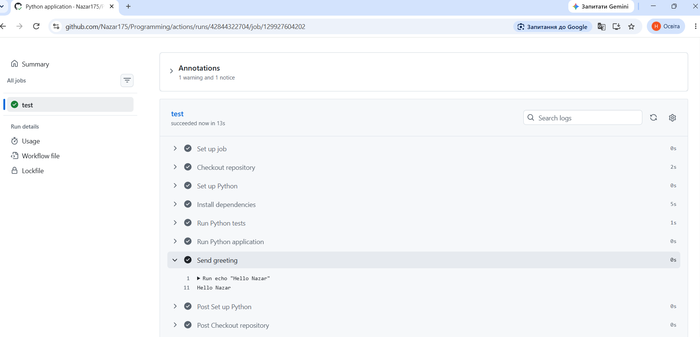
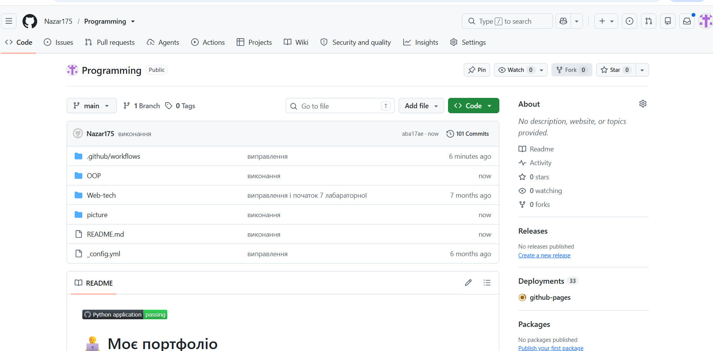

# Звіт до роботи
## Тема: Автоматизація за допомогою GitHub Actions
### Мета роботи: Навчитися використовувати GitHub Actions для автоматизації тестування.

---
## Виконання роботи:

Посилання на файл з виконаними матеріалами лекцій [тут](/OOP/testing/test_5/lecture/)

#### Для виконання лабараторної роботи було взято файли з попередньої роботи для цього завдання з GiyHub Actaions.

* Результати виконання завдання:
    1. Створено GitHub Action workflow в репозиторії:
    2. Налаштовано тригери, встановлення залежностей та запуск тестів:
    3. Результат ручного запуску Workflow:
    4. Виконано робота з налаштуванням Cron для автоматичного запуску Workflow:
    5. Створення Workflow з двома завданнями:
    6. Добавлено ще два завдання в Workflow:
    7. Зроблена своя умова виконання для запуску завдання:
    8. Добавлено Badge для Workflow у корінний README:
    ---

    Сама програма з виконаними завданнями [тут](/OOP/testing/test_5/tests/)
    ---
---
### Висновок:
- Автоматизовано тестування за допомогою GitHub Actions;
- Мета була досягнута;
- Отримані знання роботи з GitHub Actions;
- Так;
- Так;
- Складностей під час роботи не виникало;
- Формат подобається.
---